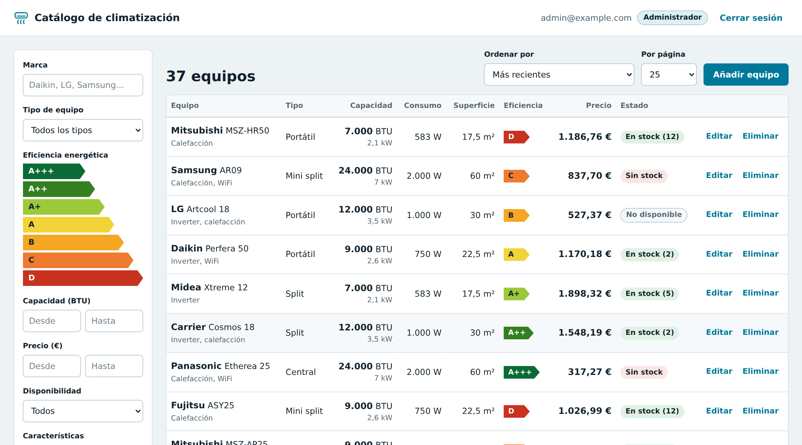
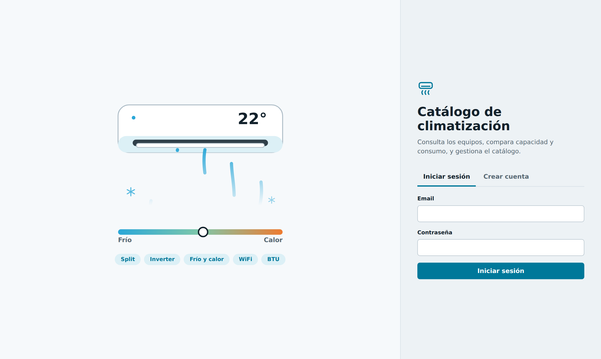
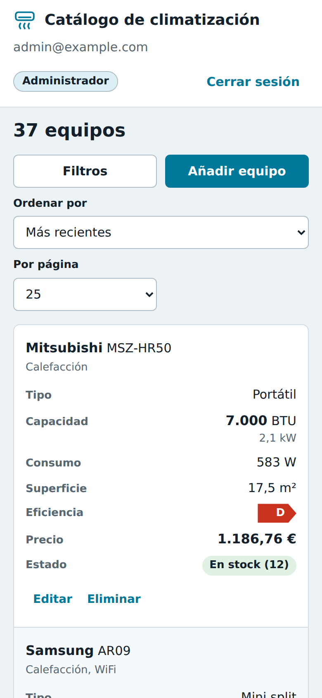
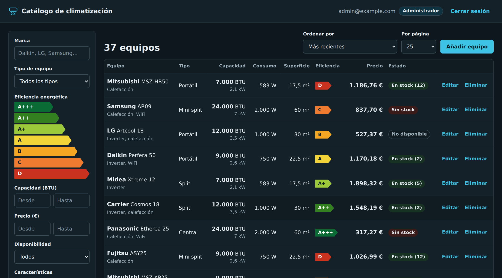

# Catálogo de climatización

**Una aplicación web para gestionar un catálogo de aires acondicionados: consultar equipos, compararlos con filtros y mantener el inventario al día, con acceso protegido por usuario y contraseña.**

## ¿Qué es y para qué sirve?

Imagina el panel interno de una tienda o una empresa de instalación de aire acondicionado. Ahí el equipo necesita responder preguntas como:

- *¿Qué equipos tenemos de 12.000 BTU, con calefacción y de clase A++ o mejor?*
- *¿Cuáles están disponibles y por debajo de 600 €?*
- *¿Quién puede cambiar los precios y quién solo consultarlos?*

Este proyecto resuelve eso: un catálogo central, ordenado y seguro, que se puede usar desde el ordenador o el móvil.

## Qué puede hacer

- **Iniciar sesión o crear una cuenta.** Todo el catálogo está protegido: sin cuenta no se ve nada.
- **Buscar y filtrar** por marca, tipo de equipo, eficiencia energética (de A+++ a D), capacidad, precio, disponibilidad y características como inverter, calefacción o WiFi.
- **Ordenar y paginar** los resultados para encontrar rápido lo que se busca.
- **Dos tipos de usuario.** Cualquier persona registrada puede consultar. Solo los administradores pueden añadir, modificar o eliminar equipos.
- **Funciona en móvil y en ordenador**, y se adapta al modo claro u oscuro del dispositivo.

| Acceso | Versión móvil | Modo oscuro |
|:---:|:---:|:---:|
|  |  |  |

> Los equipos que aparecen en las capturas son datos de demostración, no productos reales.

## Qué demuestra este proyecto

Más allá de lo que se ve, el proyecto está construido como se haría en un entorno profesional:

| En lenguaje sencillo | Cómo está resuelto |
|---|---|
| **Seguridad de acceso** | Contraseñas guardadas cifradas, sesiones con caducidad y bloqueo temporal tras varios intentos fallidos de entrada. |
| **Permisos por rol** | Cada acción comprueba quién la pide: consultar es para todos los usuarios registrados, modificar solo para administradores. |
| **Base de datos ordenada** | La estructura de datos se versiona con migraciones, de modo que se puede recrear o actualizar sin perder información. |
| **Calidad comprobada** | 33 pruebas automáticas verifican el acceso, los permisos, los filtros y el panel. Se ejecutan solas en cada cambio. |
| **Interfaz propia y ligera** | El panel web está hecho sin librerías externas, con protección contra contenido malicioso y adaptado a móvil y ordenador. |
| **Documentación** | Esta página para cualquier persona y una [guía técnica](docs/guia-tecnica.md) para quien quiera ejecutarlo o ampliarlo. |

**Tecnologías:** Python · FastAPI · PostgreSQL · SQLAlchemy · Alembic · JWT · Pydantic · pytest · GitHub Actions · HTML, CSS y JavaScript

## Probarlo en tu equipo

Necesitas Python y PostgreSQL instalados. Los pasos completos, con los comandos para Windows, están en la **[guía técnica](docs/guia-tecnica.md)**. En resumen:

1. Instalar las dependencias y copiar `.env.example` a `.env` con tus datos.
2. Crear la base de datos con `alembic upgrade head`.
3. Crear el primer administrador con `python create_superuser.py`.
4. Arrancar con `python -m uvicorn app.main:app` y abrir `http://localhost:8000/panel/`.

La documentación interactiva de la API queda disponible en `http://localhost:8000/docs`.

## Sobre mí

Soy **Federico Serra**. Este proyecto forma parte de una serie de proyectos pequeños que voy publicando para practicar y mostrar mi forma de trabajar.

- LinkedIn: [Federico Serra en LinkedIn](https://www.linkedin.com/in/federico-serra-a8050116b/)
- Correo: federicoserra01@gmail.com

## Licencia

Publicado bajo licencia [MIT](LICENSE): puedes usarlo y adaptarlo libremente citando al autor.
